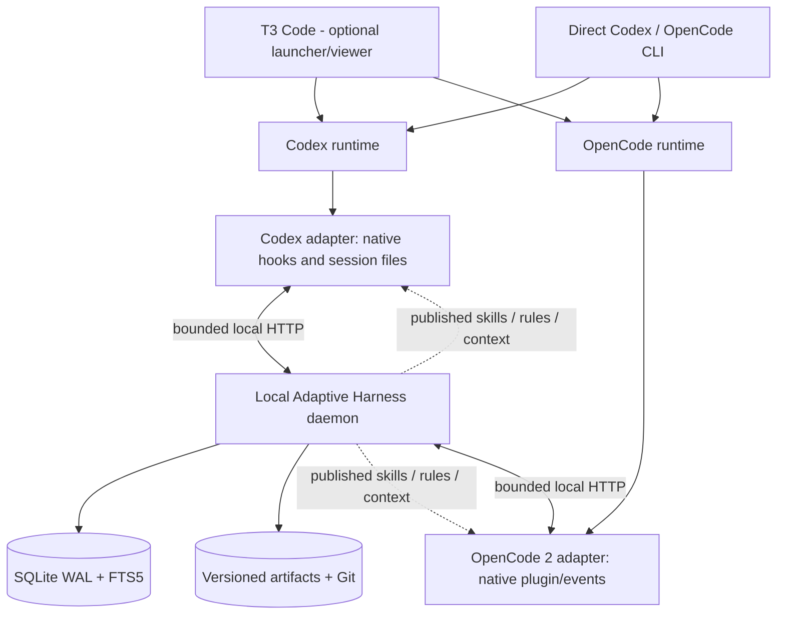

# Adaptive Harness V1 — Technical architecture

Status: **Implemented in part** · Updated: 2026-11-03 · Target: Codex and OpenCode 2.x, Windows 11 and Linux.

## Context and boundaries

Adaptive Harness is an independently deployable learning service. It observes existing coding-agent sessions and publishes reusable memory, rules and skills through each provider's supported mechanisms. It **must not** schedule agent work, own model OAuth, replace Codex App Server/OpenCode runtime, modify T3 orchestration internals, or become a prerequisite for completing an agent turn.

T3 Code is an optional UI/launcher. Direct CLI usage and T3-launched usage must share the same learning system. A feature probing a provider must record actual capabilities; never infer availability from the provider name alone.

## Context diagram

## Internal bounded contexts

- **Connector**: translates provider-native event types to canonical envelopes, reports capabilities and scope, supplies context at supported hook points; carries no learning rules.
- **Ingestion**: authenticates local callers, enforces size/schema/sanitization constraints, deduplicates events and appends to SQLite.
- **Job runner**: persisted work queue with leasing, retries, dead-letter and per-project fairness; asynchronous to the agent.
- **Memory**: extracts typed facts/decisions/lessons/procedures; de-duplicates using grounded evidence, scores provenance and performs scoped retrieval.
- **Learning**: detects signals and produces immutable candidate proposals from eligible evidence; may call an inference provider within configured spending limits.
- **Evaluation**: runs deterministic static gates, historical replay and optional A/B task-level regression on isolated copies.
- **Registry/Publisher**: stores immutable artifact versions, enforces scope and promotion gates, makes releases available to native provider config directories; auditable rollback.
- **Loop Guard**: optional, deterministic per-session signatures. Blocking only through provider-approved pre-tool hooks, with explicit per-capability checks.
- **Observability**: trace IDs, queue state, outcomes and cost estimation; no raw prompts by default. The daemon serves a **local read-only GUI** with single-use CLI pairing and scoped browser sessions.

## Operating modes

1. **Connected**: daemon reachable; observed events are accepted and processed asynchronously; context resolved from bounded memory.
2. **Degraded**: daemon unreachable; agents proceed; connectors may use a bounded user-private append-only spool; no blocking.
3. **Standalone**: CLI-launched sessions use identical connectors and project scoping.
4. **Offline inference**: ingestion and deterministic analysis continue; LLM work remains queued for a configured backend.
5. **Read-only**: persistence/publisher degraded; do not write agent configuration; all provider work continues.

## Cross-cutting invariants

- Only adapters depend on provider-specific SDKs and formats. Core never imports T3 Code packages.
- Duplicate and out-of-order events are harmless. Every event has a producer-stable ID, schema version and an observed timestamp.
- A session resolves immutable **published** artifact versions; an in-flight turn never sees a half-written artifact.
- Raw transcript text and secrets are excluded from ingestion unless a per-project opt-in and sanitization policy permits excerpts.
- Project scope is isolated. Global promotion never transports client source, paths, credentials or identifiable identifiers.
- An unavailable observer, learner, evaluation queue or publisher cannot fail a provider turn.
- Runtime-blocking decisions, if enabled, are deterministic and have a strict timeout. Unsafe commands remain controlled by provider-native permissions.
- Developer-controlled extension files and executable hooks are **not** auto-promoted in V1.
- No direct writes into provider runtime databases or T3 internal SQLite.

## Proposed stack

- TypeScript with Node.js 24 LTS (the exact supported Node minor is pinned during implementation), pnpm workspace, Zod schemas, Vitest.
- One local daemon, plus thin connector packages and a CLI for install/doctor/status.
- HTTP bound to 127.0.0.1 with bearer authentication; port and token discovered from permission-restricted user files. No wildcard bind.
- SQLite (WAL, foreign keys, busy timeout, indexed events, persistent queue) and FTS5; a single writer process.
- Published SKILL.md and rule assets in a Harness-owned directory, versions recorded in SQLite and Git commits.
- Provider inference behind an interface; model and price configured per scope; no proxying of the native agents' LLM traffic.
- Git worktree or isolated temp directory for nontrivial evaluation; never execute untrusted project commands on the user's main working copy.

## Interface boundaries

See [events](../contracts/events.md), [provider contract](../contracts/adapter.md), [HTTP API](../api/openapi.yaml), [storage](../spec/storage.md) and [security](../spec/security.md).

## Out of scope

Agent orchestration, DAG task management, model/account authentication proxy, multi-device synchronization, remote deployment, central telemetry, automatic arbitrary hook generation, self-modifying application code, remote administrative web UI, background task execution in T3.

## Tracked integration unknowns

The following are hypotheses until Spike 0 provides recordings and reproduction steps:

1. OpenCode 2 provider plugin lifecycle and event completeness when the OpenCode server is started by T3 with OPENCODE_CONFIG_CONTENT set.
2. Codex App Server hook lifecycle, subagent coverage, trust and transcript availability when launched by T3; behavior of Codex shadow-home profiles.
3. Whether completed subagent results and parent IDs can be correlated without reading private T3 storage.
4. Native agent skill/rule installation and reload semantics (global vs project, precedence, in-flight sessions).
5. Windows native vs WSL environment separation, paths and permission-safe local transport.

If direct provider integration fails: first degrade to read-only provider history; only then propose a bounded **optional T3 telemetry export** with an ADR. Never alter the execution loop to satisfy the observer.

