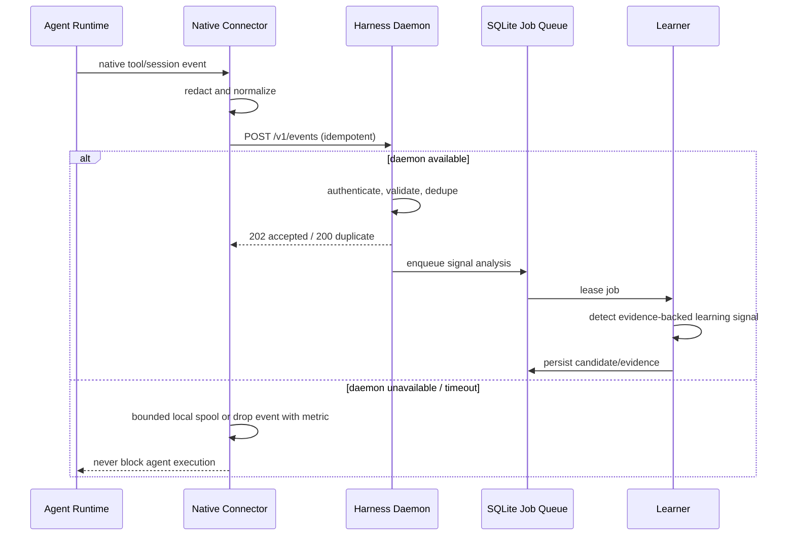
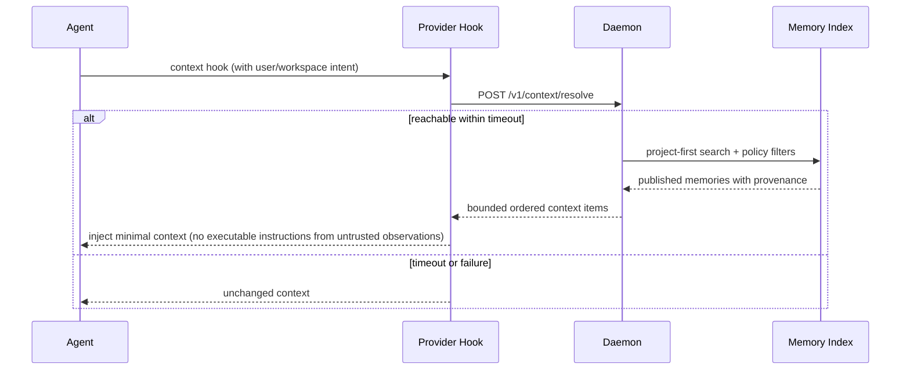
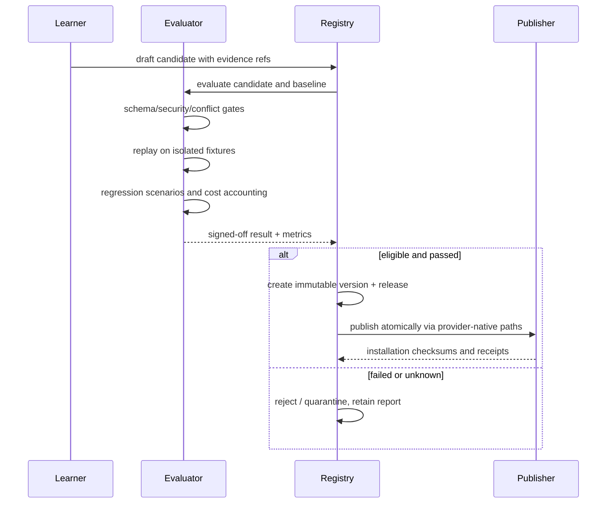

# Sequences and failure behavior

## Observation → asynchronous learning

## Context resolution

## Candidate evaluation and publication

## Crash and replay rules

Events are stored before returning an acceptance receipt. The processing cursor is represented by completed job records, not an in-memory counter. Leases expire and can be safely reacquired. A job must have a deterministic idempotency key. Crash between event insertion and enqueue is resolved by a reconciliation scan. Publishing is staged into a temporary file then atomically renamed where supported, with hashes verified before activation. Replaying a duplicate event or publication request must not generate additional releases.

